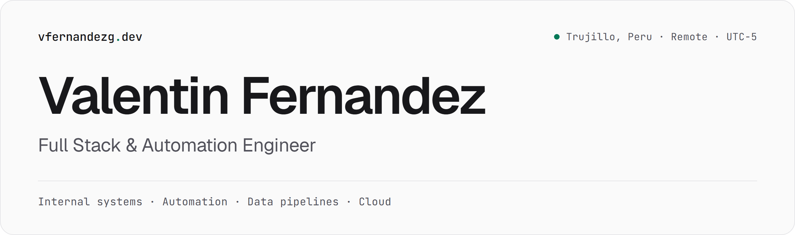
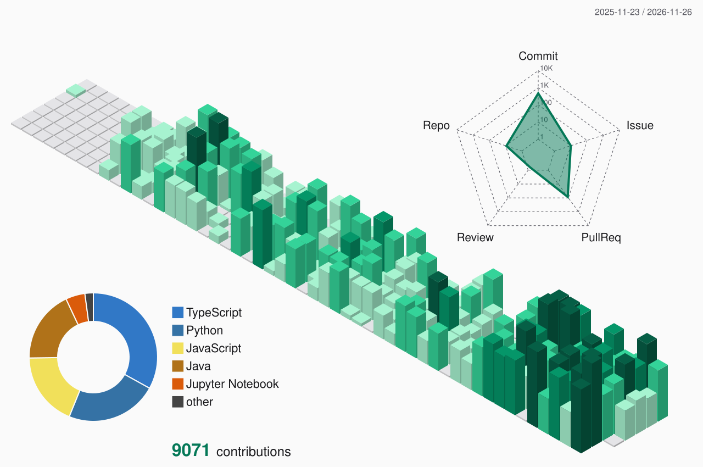

<picture>
  <source media="(prefers-color-scheme: dark)" srcset="assets/banner-dark.png" />
  
</picture>

I build internal systems that replace spreadsheets, phone calls and disconnected tools, and I own them end to end: data model, backend, frontend, data pipelines and deployment.

**[Portfolio](https://vfernandezg.dev)** · [LinkedIn](https://www.linkedin.com/in/vfernandezg-dev/) · [me@vfernandezg.dev](mailto:me@vfernandezg.dev)

## Now

Building **[HyperTier](https://github.com/vfernandezg-dev/HyperTier)**, my own open-source project: a tiered-memory inference runtime to run large AI models on small GPUs. It is in early development; the hardware measurement layer is built. [Case study](https://vfernandezg.dev/projects/hypertier/)

## Selected projects

| Project | What it is | Read more |
| --- | --- | --- |
| **[HumanAIz](https://github.com/vfernandezg-dev/humanaiz-sick-leave-verification)** | AI-assisted verification of sick leave certificates: the AI reads the certificate, rules in code validate it and Human Resources decides. First place at the Grupo Rocío hackathon. | [Case study](https://vfernandezg.dev/projects/humanaiz/) · [Demo](https://humanaiz.vfernandezg.dev) |
| **[Airbnb market analytics](https://github.com/vfernandezg-dev/airbnb-market-analytics)** | Batch pipeline on Apache Spark and HDFS that processes open data for 12 cities, trains a price model and publishes the results to a web dashboard. | [Case study](https://vfernandezg.dev/projects/airbnb-market-analytics/) · [Dashboard](https://bigdata-airbnb.vfernandezg.dev) |
| **[Healthy Bites](https://github.com/vfernandezg-dev/healthybites-backend)** | Nutrition and habits platform with three roles: clients track goals and habits, nutritionists publish plans, and an admin manages users and billing. | [Case study](https://vfernandezg.dev/projects/healthy-bites/) |
| **[LocalSpeakerTranscriber](https://github.com/vfernandezg-dev/LocalSpeakerTranscriber)** | Local pipeline that turns a recording into a transcript attributed to each speaker, without sending the audio to external services. | [Case study](https://vfernandezg.dev/projects/local-speaker-transcriber/) |

## Stack

<picture>
  <source media="(prefers-color-scheme: dark)" srcset="assets/stack-dark.svg" />
  
</picture>

## Contributions

<picture>
  <source media="(prefers-color-scheme: dark)" srcset="profile-3d-contrib/contributions-dark.svg" />
  
</picture>
